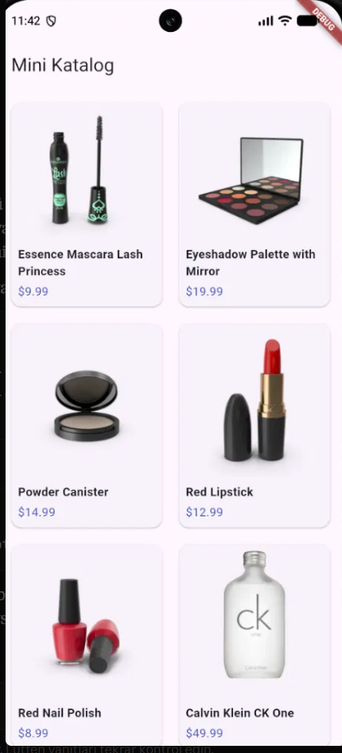
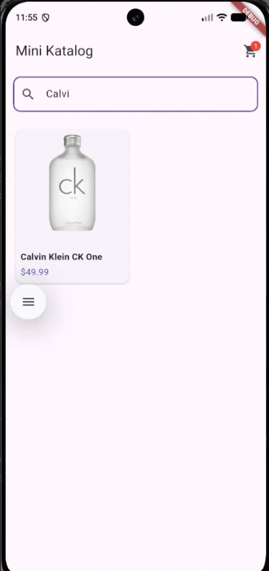
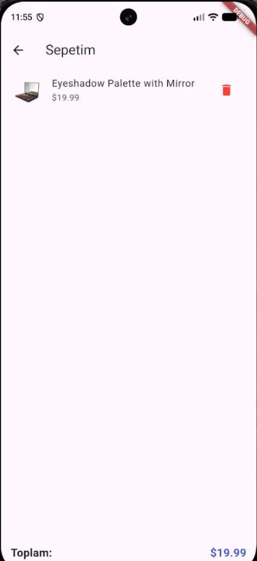

# Mini Katalog

Flutter ile geliştirilmiş basit bir ürün katalog uygulaması. Kullanıcılar ürünleri listeleyebilir, detaylarını inceleyebilir, arama yapabilir ve basit bir sepet sistemiyle ürün ekleyip çıkarabilir.

## Özellikler

- Ana sayfa — ürün listesi (GridView ile kart tabanlı tasarım)
- Ürün detay sayfası (Navigator ve Route Arguments ile sayfa geçişi)
- Canlı arama / filtreleme
- Sepet sistemi (Provider ile state yönetimi, ekleme/silme, toplam fiyat hesaplama)
- API entegrasyonu ([DummyJSON](https://dummyjson.com/products)) ve JSON'dan model sınıfına dönüşüm (fromJson)

## Kullanılan Flutter Sürümü

Flutter 3.47.6 (stable channel)

## Kullanılan Paketler

- `http` — API'den veri çekmek için
- `provider` — sepet state'ini sayfalar arasında paylaşmak için

## Proje Yapısı

```
lib/
├── models/
│   ├── product.dart       (Ürün veri modeli, fromJson)
│   └── cart.dart          (Sepet state yönetimi)
├── screens/
│   ├── home_screen.dart           (Ana sayfa — liste, arama)
│   ├── product_detail_screen.dart (Ürün detay sayfası)
│   └── cart_screen.dart           (Sepet sayfası)
├── api_service.dart        (API isteği ve veri çekme)
└── main.dart                (Uygulama giriş noktası)
```

## Çalıştırma Adımları

1. Projeyi klonlayın:
```
   git clone <repo-url>
```
2. Proje klasörüne girin:
```
   cd mini_katalog
```
3. Bağımlılıkları yükleyin:
```
   flutter pub get
```
4. Bir Android emulator başlatın veya bir cihaz bağlayın.
5. Uygulamayı çalıştırın:
```
   flutter run
```
### Ana Sayfa — Ürün Listesi


### Ürün Detay Sayfası


### Arama / Filtreleme


### Sepet Sayfası


## Veri Kaynağı Hakkında

Bu projede kullanılan ürün verileri [DummyJSON](https://dummyjson.com/) adresinden, eğitim/demo amaçlı olarak çekilmektedir. Gerçek bir e-ticaret altyapısını temsil etmez.

